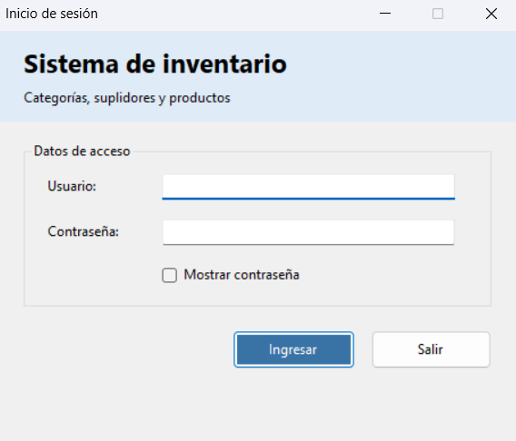
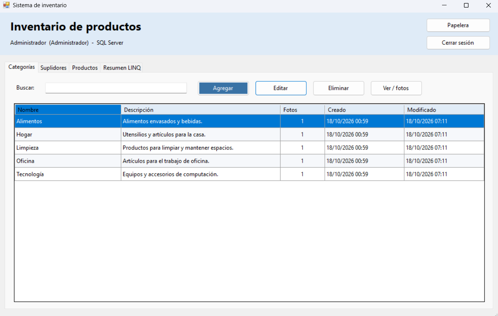
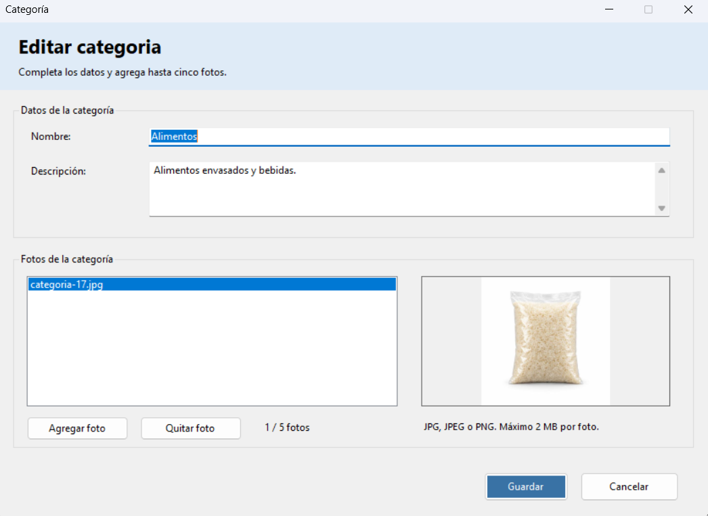
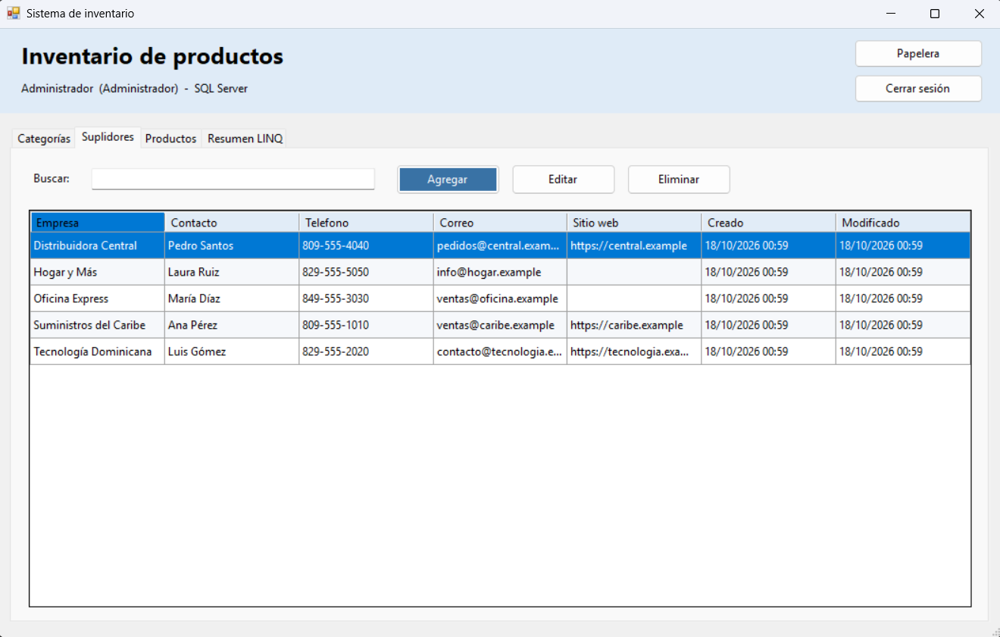
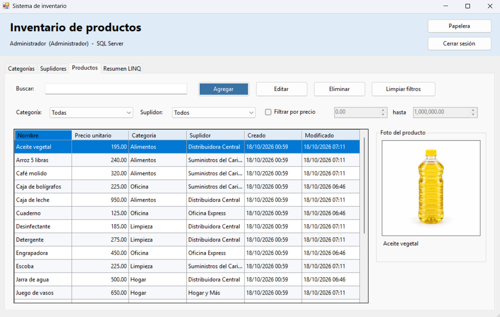
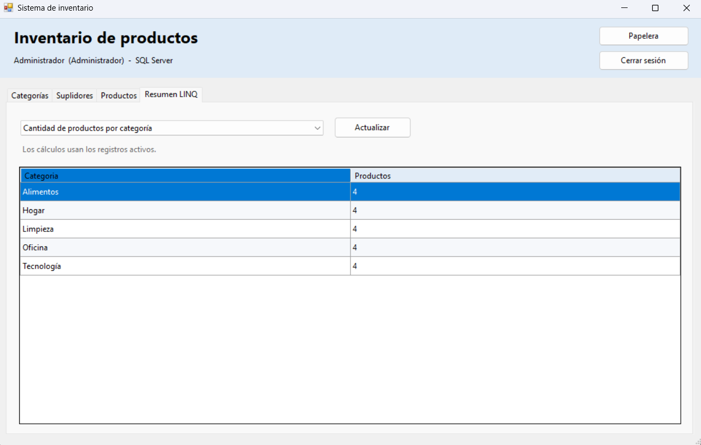

# Sistema de inventario

Programa sencillo en C# y Windows Forms para administrar categorías, suplidores y productos. Usa controles normales de Windows Forms, sin plugins gráficos. Los formularios se pueden editar desde el diseñador de Visual Studio.

Incluye login con dos roles, fotos de categorías y productos, búsquedas, filtros de productos, papelera y consultas LINQ. **Siempre trabaja con SQL Server. Los datos de ejemplo se insertan en la base mediante `database/datos.sql`.**

## 1. Preparar Visual Studio

1. Extrae toda la carpeta a una ruta local, por ejemplo `C:\Proyectos\SistemaInventario`.
2. Instala en Visual Studio la carga **Desarrollo de escritorio de .NET** y el **Developer Pack / Targeting Pack de .NET Framework 4.8**. Puedes usar Visual Studio 2022 o posterior con esos componentes.
3. Abre `src\SistemaInventario.sln` y espera la restauración de NuGet.
4. Establece `SistemaInventario.Presentacion` como proyecto de inicio.

El paquete `Microsoft.NETFramework.ReferenceAssemblies` solo ayuda a compilar contra .NET Framework; no agrega controles ni cambia la interfaz.

## 2. Crear la base y cargar los ejemplos

Necesitas SQL Server y SQL Server Management Studio (SSMS). Los scripts requieren SQL Server 2016 SP1 o posterior.

1. Abre SSMS y conéctate a tu servidor con una cuenta que pueda crear bases.
2. Abre `database\schema.sql` y ejecútalo completo. Crea `SistemaInventarioDB`, sus tablas, relaciones y procedimientos.
3. Abre `database\datos.sql` y ejecútalo completo **después** de `schema.sql`.
4. Encontrarás 5 categorías, 5 suplidores y 20 productos activos, dos usuarios y unos registros inactivos para probar la papelera. Cada categoría activa de ejemplo tiene una foto propia, y los 20 productos activos ya traen fotos completas; puedes cambiarlas desde el programa.

Si ya tenías la versión anterior, vuelve a ejecutar primero `schema.sql` y después `datos.sql`: se conservan tus registros y fotos personalizadas, se corrigen las fotos de ejemplo mal cortadas y se agrega una foto a cada categoría de ejemplo que aún no tenga ninguna.

Los scripts no borran la base ni repiten los ejemplos que ya existan por nombre. Los registros que crees desde la aplicación quedan guardados en SQL Server.

## 3. Configurar la conexión y ejecutar

En `src\SistemaInventario.Presentacion\App.config`, cambia el servidor de la conexión **InventarioDB** por el de tu instalación:

```xml
<add name="InventarioDB"
     connectionString="Data Source=.\SQLEXPRESS;Initial Catalog=SistemaInventarioDB;Integrated Security=True;Connect Timeout=8;TrustServerCertificate=True"
     providerName="System.Data.SqlClient" />
```

| Instancia que utilizas | Ejemplo de Data Source |
|---|---|
| SQL Server Express | `.\SQLEXPRESS` |
| SQL Server LocalDB | `(localdb)\MSSQLLocalDB` |
| Instancia predeterminada local | `localhost` |

Usa el mismo nombre que te funcionó en SSMS. La conexión incluida utiliza autenticación de Windows; esa cuenta necesita acceso a la base.

Compila la solución y presiona **F5**. Entra con una de estas cuentas, creadas por `datos.sql`:

| Usuario | Contraseña | Rol |
|---|---|---|
| admin | Admin123! | Administrador |
| usuario | Usuario123! | Usuario normal |

Las claves son de ejemplo para la práctica. La tabla Usuarios guarda su hash PBKDF2 y sal, no la contraseña en texto plano. Si SQL Server está apagado o la base no está preparada, el login mostrará un error de conexión.

## 4. Editar los formularios

En `SistemaInventario.Presentacion`, haz clic derecho en **LoginForm.cs**, **PrincipalForm.cs** o el formulario que quieras cambiar y selecciona **Ver diseñador** (Shift+F7).

Cada formulario incluye `.cs`, `.Designer.cs` y `.resx`. El constructor sin parámetros solo crea controles; no abre SQL Server. Puedes mover los controles y cambiar sus propiedades desde Visual Studio.

Si falta el diseñador, revisa la carga de escritorio, abre la solución completa y compila. Si aparece MSB3644, instala el Developer Pack de **4.8**.

## Permisos

| Acción | Administrador | Usuario normal |
|---|---|---|
| Consultar categorías, suplidores y fotos | Sí | Sí |
| Crear o editar categorías y suplidores | Sí | No |
| Crear o editar productos | Sí | Sí |
| Eliminar y restaurar registros | Sí | No |
| Buscar, filtrar y consultar resúmenes | Sí | Sí |

Los servicios revisan los permisos además de los botones del formulario.

## Contenido

| Carpeta | Para qué sirve |
|---|---|
| `src` | Solución y código de los cuatro proyectos |
| `database` | Creación de la base y datos de ejemplo |
| `docs` | Diagramas de clases y entidad-relación, y capturas |
| `build` | Compilación Release y script para volver a compilar |

- [Diagrama de clases UML](docs/diagramas/clases.png)
- [Diagrama entidad-relación](docs/diagramas/entidad-relacion.png)

## Conteo de fotos en categorías

La columna **Fotos** muestra la cantidad de fotos propias guardadas en cada categoría, entre 0 y 5. Cambia al guardar después de agregar o quitar imágenes. Las fotos de sus productos se administran por separado. Los ejemplos de `datos.sql` incluyen una foto por categoría.

## Fotos de productos

En el editor puedes elegir o quitar una foto JPG, JPEG o PNG de hasta 2 MB. La imagen se guarda dentro de SQL Server. Al seleccionar un producto en el listado, su foto aparece a la derecha. Las imágenes de ejemplo fueron generadas para esta práctica y vienen incluidas en `datos.sql`; no se descargan de Internet al ejecutar el programa.

## Capturas de los formularios

Estas capturas muestran los formularios de esta versión. Se abrieron con Mono durante la revisión de interfaz; las pantallas de productos se comprobaron con datos aislados de prueba fuera de la aplicación entregada, ya que este entorno no tiene SQL Server. En Windows los controles adoptan su apariencia nativa.

**Inicio de sesión**



**Listado de categorías y contador de fotos**



**Editor de categorías y fotografías**



**Listado de suplidores**



**Productos con filtros y vista previa de foto**



**Resumen de consultas LINQ**




## Compilación Release

Puedes seleccionar **Release / Any CPU** en Visual Studio. También puedes abrir Developer Command Prompt de Visual Studio y ejecutar desde la raíz:

```bat
build\CompilarRelease.cmd
```

El archivo listo es `build\SistemaInventario.Presentacion.exe`; conserva las tres DLL y su `.exe.config` en la misma carpeta. Si ejecutas esta copia, configura el servidor en `build\SistemaInventario.Presentacion.exe.config`.

Los errores se registran en `%LOCALAPPDATA%\SistemaInventario\errores.log`. La entrega elimina las carpetas temporales `bin`, `obj` y `.vs`, pero conserva `/build` porque el mandato requiere el ejecutable Release.

## Referencias de instalación

- [Windows Forms](https://learn.microsoft.com/dotnet/desktop/winforms/overview/)
- [Developer Pack de .NET Framework](https://learn.microsoft.com/dotnet/framework/install/guide-for-developers)

## Estado del ejecutable incluido

Se conserva el ejecutable y sus dependencias que venían en `build` en el ZIP original. No se recompilaron durante la organización, por lo que no se ha verificado que correspondan al código fuente actual ni que su configuración sea Release. Para generar una versión Release actualizada desde el código, ejecuta `build\CompilarRelease.cmd` en Developer Command Prompt de Visual Studio.
